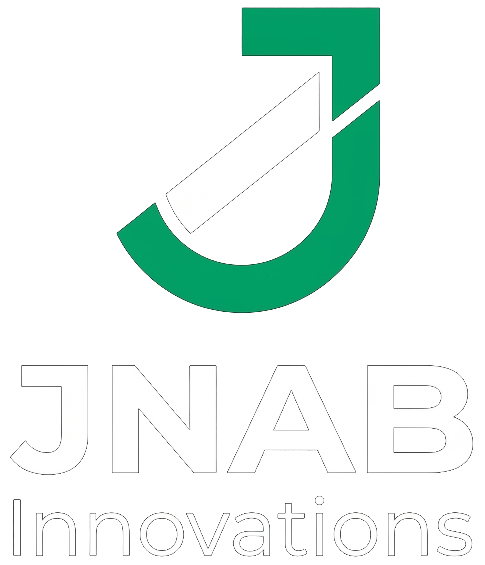

# JNAB Innovations · Full-Stack Monorepo

<p align="center">
  
</p>

<p align="center">
  <strong>Architecting High-Performance Products · Powered by Next-Gen African Talent</strong>
</p>

<p align="center">
  
  
  
  
  
  
</p>

---

## 🏗️ Repository Architecture

This repository contains the complete full-stack web platform for **JNAB Innovations** (operating brand of **JNAB Tech Solutions**):

```text
JNAB/
├── backend/                  # Django REST Framework Backend
│   ├── env/                  # Python Virtual Environment
│   ├── jnab_backend/         # Core project settings & root URLs
│   │   ├── settings.py       # Configured with DRF, CORS, Media & Static roots
│   │   └── urls.py           # Root routing with API include
│   ├── api/                  # Business Logic App
│   │   ├── models.py         # JobPosition, JobApplication, Inquiries
│   │   ├── serializers.py    # DRF serializers with data validation
│   │   ├── views.py          # API endpoints (GET, POST multipart/json)
│   │   ├── urls.py           # REST routing (/api/careers/, /api/inquiries/)
│   │   ├── admin.py          # Django Admin with filters & resume inspection
│   │   └── management/       # Commands (python manage.py seed_careers)
│   ├── manage.py
│   └── requirements.txt
│
└── frontend/                 # React 18 + TypeScript + Vite Frontend
    ├── src/
    │   ├── components/       # UI Components & Specialized Modals
    │   │   ├── JobApplicationModal.tsx  # Dedicated Career Application Form
    │   │   ├── QuoteEstimatorModal.tsx  # Product Build, Talent Pod & Academy Form
    │   │   ├── JoinUsCareers.tsx        # Live synced career opportunities
    │   │   ├── Navbar.tsx, Hero.tsx, CoreServices.tsx, etc.
    │   ├── services/
    │   │   └── api.ts        # Type-safe API client connecting to Django backend
    │   ├── App.tsx
    │   └── main.tsx
    ├── public/               # Logos, Brand Assets & Favicon
    ├── package.json
    └── vite.config.ts
```

---

## 🚀 Quick Start Guide

### 1. Start the Django Backend

```bash
cd backend
source env/bin/activate
python manage.py runserver 0.0.0.0:8000
```

* **API Root**: `http://localhost:8000/api/`
* **Django Admin Portal**: `http://localhost:8000/admin/`
  * **Username**: `admin`
  * **Password**: `admin1234`

### 2. Start the React Frontend

Open a new terminal window:

```bash
cd frontend
npm install
npm run dev
```

* **Frontend Web App**: `http://localhost:5173/`
* **Local Network (Mobile Testing)**: `http://192.168.1.187:5173/`

---

## 📡 REST API Reference

| Method | Endpoint | Description | Payload Type |
| :--- | :--- | :--- | :--- |
| `GET` | `/api/careers/` | List all active career openings (supports `?department=`) | JSON Response |
| `GET` | `/api/careers/<slug>/` | Retrieve complete details of a specific job role | JSON Response |
| `POST` | `/api/careers/apply/` | **Dedicated Job Application Form** (Resume upload/link, GitHub, LinkedIn) | Multipart / JSON |
| `POST` | `/api/inquiries/product-build/` | **Product Build Form** (Type, budget, timeline, scope, Figma link) | JSON |
| `POST` | `/api/inquiries/hire-talent/` | **Hire Talent / Tech Pod Form** (Model, roles, seniority, duration) | JSON |
| `POST` | `/api/inquiries/academy/` | **JNAB Academy Form** (Track, experience, mode, scholarship) | JSON |
| `POST` | `/api/inquiries/contact/` | General website inquiry or quick consultation trigger | JSON |

---

## 🛡️ Form Distinction Overview

As requested, forms are strictly separated to reflect distinct user intents:

1. **Career Applicants**:
   * **Target Audience**: Software Engineers, UI/UX Designers, DevOps Specialists.
   * **Fields**: Target Position, Full Name, Email, Phone, Location, Years of Experience, Portfolio Link, GitHub Profile, LinkedIn URL, Resume Upload (PDF/DOCX), Cover Note.
   * **Endpoint**: `/api/careers/apply/`

2. **Product Build Inquiries**:
   * **Target Audience**: Founders, Enterprises, Venture Studios.
   * **Fields**: Full Name, Company, Work Email, Phone, Project Type, Budget Range, Timeline, Scope / Problem Statement, Spec/Figma link.
   * **Endpoint**: `/api/inquiries/product-build/`

3. **Hire Talent & Dedicated Pods**:
   * **Target Audience**: CTOs, Engineering Leaders needing talent augmentation.
   * **Fields**: Company, Work Email, Engagement Model (Embedded vs. Pod), Roles Needed, Seniority Level, Headcount, Duration.
   * **Endpoint**: `/api/inquiries/hire-talent/`

4. **JNAB Academy Fellowships**:
   * **Target Audience**: Early-to-mid career developers & aspiring designers.
   * **Fields**: Full Name, Email, Phone, Track (Product Design vs. Full-Stack), Skill Level, Learning Mode, Motivation Statement, Scholarship Request.
   * **Endpoint**: `/api/inquiries/academy/`

5. **Contact Us Page Inquiries**:
   * **Target Audience**: Clients, prospective partners, general inquiries.
   * **Fields**: Full Name, Work Email, Phone, Company, Inquiry Type / Intent, Subject, Message Brief.
   * **Endpoint**: `/api/inquiries/contact/`

---

## 📧 Automated Email Notifications (Resend + Anymail)

All five submission endpoints automatically dispatch an instant, high-contrast HTML notification email to the administrator whenever a user submits a form or requests a quote.

### Environment Variables
To enable Resend in production (PythonAnywhere) or locally, add to your `.env`:

```env
# Resend API Key (from https://resend.com)
RESEND_API_KEY=re_your_api_key_here

# Sender Email (use onboarding@resend.dev during testing, or your verified domain e.g. notifications@jnab.tech)
DEFAULT_FROM_EMAIL=JNAB Innovations <onboarding@resend.dev>

# Where alerts are delivered (supports multiple comma-separated emails)
ADMIN_NOTIFICATION_EMAIL=hello@jnab.tech
```

* In **development**: If `RESEND_API_KEY` is not set, emails print directly to the console (`EmailBackend`).
* In **production**: When `RESEND_API_KEY` is set, emails send via `anymail.backends.resend.EmailBackend`.


---

## 📄 License & Ownership

Copyright © 2026 **JNAB Tech Solutions** (operating as **JNAB Innovations**). All rights reserved.  
Accra Innovation Quarter · Ghana & Global Remote.
